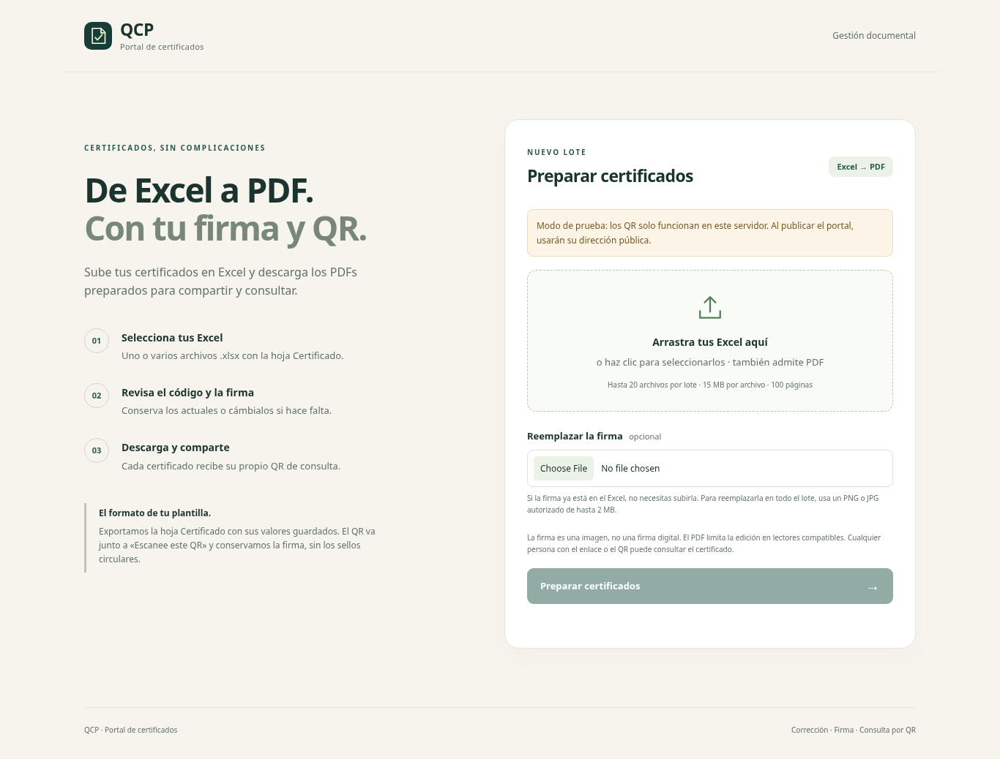

# Portal de certificados QCP

Aplicación web en español para convertir certificados Excel a PDF por lotes, con una imagen de firma y un QR por certificado. Basada en el comportamiento del flujo n8n **«Portal certificados QCP - lotes dinámicos v3»**, con una implementación independiente: no necesita n8n, QuickChart ni el servicio externo `pdf-code-fixer`.

El portal revisa primero la hoja que contiene el certificado. Si incluye fondo, encabezado o pie, **conserva ese formato y no añade otro fondo**. Solo cuando no incluye ninguno pide elegir **Acreditado** o **No acreditado** para añadir el fondo oficial a todas las páginas. En este último caso reserva espacio para el membrete y los datos de contacto. La firma, datos guardados de fórmulas, QR y resolución original se conservan.

Cuando se añade un fondo oficial, antes de guardar el PDF final se comprueba página por página: imagen oficial, una aparición, resolución y posición de página completa detrás del contenido. Fondos ausentes, duplicados, desplazados, páginas fuera de A4 vertical e imágenes opacas que tapen el fondo completo detienen la emisión. Para formatos existentes, se conserva la imagen de fondo y se restauran las imágenes VML de encabezado/pie que LibreOffice omite, respetando sus variantes de primera página y páginas pares. El resultado distingue «Formato del Excel conservado» de «Fondo oficial verificado». Estos controles no sustituyen la revisión de los datos de calibración. Los PDF que se suben directamente mantienen su contenido existente.

Los dos originales se versionan en `app/assets/` y sus hashes se registran en `app/backgrounds.py`. El fondo acreditado se extrajo del Excel autorizado y el no acreditado del archivo proporcionado por el usuario, sin modificar las imágenes. Ambos conservan sus 2482 × 3508 píxeles y 300 dpi para impresión.



La pantalla usa el nombre y el emblema de **Quality Control Perú S.A.C.**, tomados del membrete de la plantilla proporcionada. Incluye una guía de tres pasos, contador de archivos, firma opcional desplegable y presentación adaptada a computadora y celular. La página de consulta comparte esa identidad visual. La ilustración del inicio es decorativa; los certificados se generan desde los archivos cargados.

## Qué hace

- Recibe hasta 20 archivos `.xlsx` o `.xlsm` por lote, sin ejecutar macros, desde el navegador, procesados uno a uno. También conserva la entrada PDF de la versión anterior. Cada archivo admite 15 MB y el resultado hasta 100 páginas.
- Exporta la hoja **Certificado** o **CERTIFICADO QCP**. En los libros de medios isotermos con variantes `Certificado_10S` / `Certificado_12S` (también con prefijo numérico), lee el valor guardado del nombre `CantSensores` del registro y selecciona únicamente la variante coincidente; informa la hoja y la razón antes de emitir. No interpreta la pestaña activa como una selección ni inventa un umbral. Si el dato no corresponde a una variante única, pide revisar ese dato. Si ambas existen, elige la que contiene la indicación del QR; ante varias indicaciones en hojas distintas, solicita resolver la ambigüedad. Conserva el área de impresión, filas de encabezado y saltos de página. Si no hay área guardada, imprime el rango con datos y celdas combinadas de esa hoja. Conserva los resultados guardados de las fórmulas; no recalcula mediciones ni actualiza conexiones de datos. El Excel original no se guarda ni se modifica.
- Lee el código y la versión del formato del pie original y de las hojas de datos/registro **antes** de eliminar hojas de la copia temporal. Conserva los identificadores del certificado; no copia los de un registro de medición u hoja de cálculo. Restaura el bloque al pie después de ajustar el contenido y verifica sus campos y la numeración global en el PDF final. Si esos datos no existen o son ambiguos, continúa con la numeración y un aviso; permite completarlos en «Pie del formato». No asigna un código o versión universal.
- En la plantilla Excel, coloca un QR de 66 puntos **a la izquierda de «Escanee este QR»**. Centra el cuadrado visible con el bloque completo de instrucciones, excluyendo el margen transparente; las leyendas cortas se alinean por arriba. Antes de entregar el PDF cifrado comprueba la geometría, lee el QR renderizado y verifica un único enlace en la primera página. Conserva la imagen de firma situada junto a «Autorizado y firmador por:» o «Autorizado y firmado por:», y omite los sellos circulares conforme al PDF de referencia. Cada archivo obtiene un identificador y un QR distintos, incluso si repite el mismo código.
- Si la plantilla trae un único QR de Drive legible y no tiene indicación de texto, actualiza ese QR en su posición. El nuevo enlace corresponde al PDF que se está emitiendo. No reutiliza el destino del certificado anterior ni añade una segunda página para el QR.
- Ajusta a la página los membretes A4 guardados como imágenes de encabezado, conservando sus píxeles originales. Reserva espacio para que el contenido impreso no tape el logotipo ni el pie. Cuando se añade un fondo oficial, el ajuste se realiza sobre las páginas ya exportadas para conservar los saltos de página del Excel. Conserva los encabezados pequeños y las variantes de página. No reduce la resolución ni vuelve a comprimir los JPEG originales.
- Detecta códigos `QCP-0000-0000`. Si existe un único código distinto, permite reemplazar todas sus apariciones por el código solicitado. Conserva el nombre base y entrega un archivo `.pdf`.
- Si hay varios códigos, los conserva y muestra una advertencia. Si no encuentra texto editable, no inventa ni corrige códigos. No incluye OCR.
- Permite reemplazar la firma del Excel mediante una imagen PNG/JPG autorizada; es opcional y se aplica al lote. La ubica a la izquierda del texto del autor. La firma no se almacena como archivo independiente.
- Si la plantilla Excel no permite ubicar el QR o la firma sin cubrir texto o imágenes, devuelve un error para corregirla. No añade páginas a esa plantilla. Para entradas PDF genéricas se mantiene la búsqueda de espacios libres y, si hace falta, una página adicional de consulta.
- Aplica cifrado AES-256 con apertura sin contraseña y permisos que limitan edición y copia en lectores compatibles. Permite imprimir. Esos permisos no garantizan que otros programas no puedan modificar el PDF.
- Con `CERTIFICATE_STORAGE_BACKEND=drive`, guarda el PDF final y sus metadatos en Google Drive. El QR abre directamente el PDF compartido mediante enlace y sigue funcionando sin el disco de Render. La consulta del portal lee el registro de Drive y muestra el hash SHA-256. El modo `local` mantiene el almacenamiento del servidor para desarrollo o un disco persistente.
- Rechaza PDFs con contraseña o campos de firma digital para no invalidarlos silenciosamente.

**La imagen de firma, el QR y el registro no constituyen una firma digital ni acreditan la identidad del emisor.** La sustitución de códigos conserva tamaño/color y aproxima la fuente con fuentes PDF estándar; documentos con tipografías especiales deben revisarse visualmente. Texto girado que requiera corrección se rechaza.

## Ejecutar en desarrollo

Requisitos: Python **3.12**, [uv](https://docs.astral.sh/uv/), **LibreOffice Calc** y fuentes Liberation, DejaVu y Carlito. En Debian/Ubuntu: `apt-get install libreoffice-calc fonts-liberation fonts-dejavu-core fonts-crosextra-carlito`. El Dockerfile instala el conversor y las fuentes automáticamente. Utiliza el checkout existente; no es necesario crear otro worktree.

```sh
cd /workspace/Chamba
sh scripts/install.sh
sh scripts/start.sh
```

En una instalación local fuera de Codex, entra en el directorio clonado de Chamba. El servidor escucha en el puerto 8000. Para cambiarlo, exporta `PORT` y `PUBLIC_BASE_URL` antes de arrancar. En desarrollo el origen por defecto es `http://127.0.0.1:8000`; los QR de ese modo sirven únicamente para pruebas en la máquina del servidor.

El archivo `.env.example` documenta los nombres de variables; **la aplicación no carga archivos `.env` automáticamente**. Exporta las variables o configúralas en tu proveedor. Nunca guardes claves ni PDFs de clientes en Git.

Para probar sin documentos reales, genera un PDF ficticio de dos páginas, súbelo al portal y solicita el código `QCP-2026-0099`:

```sh
.venv/bin/python scripts/create_demo.py --output /tmp/qcp-demo.pdf
```

## Validar

```sh
cd /workspace/Chamba
.venv/bin/python -m pytest -q
```

Las pruebas generan Excel y PDFs ficticios; comprueban la conversión, resultados de fórmulas sin recálculo, exportación de una sola hoja, QR al costado y distinto por archivo, eliminación de sellos, conservación/reemplazo de firma, corrección del código, permisos, almacenamiento y errores. Drive se prueba con respuestas simuladas: persistencia después de perder el almacenamiento local, enlaces distintos, integridad y cancelación de publicaciones incompletas. No utilizan certificados de clientes ni escriben en Google. Las pruebas de Excel requieren LibreOffice.

## Preparar el Excel

Usa un archivo `.xlsx` o `.xlsm` con una hoja llamada **Certificado** o **CERTIFICADO QCP** y una indicación del espacio para el QR visible en la primera página, o un único QR de Drive legible ya colocado en esa página. La lectura se hace sobre el PDF convertido, por lo que reconoce textos de celdas o cuadros de texto y frases como **Escanee este QR** o **Código QR**, incluso divididas en varias líneas. No se requiere un área de impresión guardada, aunque se respeta cuando existe; también reconoce los nombres `Print_Area` y `Print_Titles` que algunos editores guardan sin el prefijo estándar. Si no se puede identificar un espacio único y libre, el portal explica el problema y no coloca el QR encima de datos. La ubicación de la firma y los sellos se reconoce en el bloque de autorización de la plantilla QCP proporcionada; otras plantillas necesitan adaptación. Si el certificado se reparte en varias hojas visibles llamadas `CERTIFICADO…`, se reconocen por el mismo código y la numeración `Página N de M`, y se unen en ese orden. Las hojas de registros y cálculos no se imprimen. Se comprueba que no falten ni se repitan páginas; el QR se coloca solo en la primera. Abre, calcula y guarda el archivo en Excel antes de subirlo: las fórmulas que se imprimen deben tener resultados guardados y sin errores. El mensaje identifica las celdas problemáticas; las filas y columnas ocultas, y las celdas fuera del área de impresión, no bloquean por errores que no se imprimen. Los títulos repetidos sí se validan. El procesamiento continúa con avisos cuando encuentra errores o resultados ausentes en celdas auxiliares configuradas con texto blanco, fórmula oculta y formato General, sin relleno, bordes ni formato condicional. Solo se vacían esas celdas en la copia temporal; no se calculan ni inventan mediciones. Los errores en datos impresos, los resultados esenciales ausentes y la falta de un código verificable sí requieren revisión antes de emitir el certificado. Los libros `.xlsm` se convierten usando sus valores guardados: se eliminan VBA, hojas de macros y controles activos de la copia temporal antes de abrirla en LibreOffice; el original permanece intacto. No se ejecutan macros ni se calculan nuevos resultados. No se admiten `.xls` ni archivos con contraseña. Los objetos incrustados de otras hojas se omiten de la copia temporal; si están en la propia hoja del certificado, el portal pide convertirlos en imágenes para conservar su aspecto sin abrir el objeto.

Se usa LibreOffice para convertir una copia temporal. El fondo existente se conserva; solo en su ausencia y sin encabezado/pie se añade el oficial elegido debajo del contenido. Las alturas de las filas se fijan para respetar los saltos. En las plantillas de fondo de hoja y márgenes cero se reserva espacio para el pie y se limita la impresión a una página de ancho, manteniendo los saltos verticales y los encabezados repetidos. Así las columnas derechas no aparecen en páginas separadas. Las demás plantillas conservan su escala fija: no se agrandan para ocupar la página. Los membretes A4 en imágenes de encabezado se restauran a página completa aunque estén guardados en la sección izquierda, central o derecha. Los formatos numéricos usan coma decimal y espacio entre millares, como el PDF de referencia; se conservan el formato General, las fechas y los formatos con moneda o región explícita. Algunas tipografías de Microsoft se sustituyen por fuentes disponibles en el servidor y pueden producir pequeñas diferencias visuales. Revisa los primeros PDFs de cada plantilla antes de usarla habitualmente.

La copia temporal contiene únicamente la hoja del certificado y los recursos que utiliza. Se eliminan conexiones, configuraciones de impresora y recursos ajenos; el PDF depura recursos sin uso, subconjunta fuentes y comprime su estructura. Cuando un JPEG repite su perfil ICC dentro de los metadatos, el PDF elimina esa copia redundante y conserva el espacio de color ICC declarado en el PDF, los datos comprimidos de la imagen, sus píxeles y resolución. Estas optimizaciones conservan texto vectorial y calidad original del fondo para impresión. Un JPEG de pocos MB puede expandirse a decenas de MB de píxeles en un lector PDF, especialmente si es CMYK; conservar la máxima resolución mantiene ese coste de visualización. La velocidad también depende del lector y del equipo. La interfaz muestra el tiempo transcurrido durante la conversión y el guardado. Cuando el código del nombre del archivo difiere del contenido, muestra un aviso y conserva el dato del documento.

Cuando falta el área de impresión, se centra horizontalmente el rango inferido sin cambiar los márgenes guardados. Los encabezados de tabla sombreados con texto ajustado en Arial, Calibri o Carlito pueden ganar altura tomando solo espacio vacío inmediatamente anterior: se mantiene la altura total del bloque, los valores, las celdas combinadas y los saltos de página. No se aplica este ajuste si hay dibujos en la hoja, combinaciones verticales o espacio insuficiente; esos formatos requieren revisión visual. La reducción del contenido entre membrete y pie se realiza alrededor del centro horizontal de la página.

Con el servidor arrancado, comprueba además una carga y descarga reales:

```sh
.venv/bin/python scripts/smoke.py
```

Esta comprobación guarda un certificado ficticio marcado SIN VALIDEZ. Usa `--url https://tu-portal.example.com` para comprobar una publicación. La carga y el procesamiento son públicos y no requieren contraseña.

## Publicar para obtener un enlace

El repositorio y la publicación web son cosas distintas: subir este código a GitHub **no inicia un servidor web**. Esta aplicación necesita un servidor Python y almacenamiento duradero: Google Drive o un disco persistente. GitHub Pages no ejecuta este backend.

Puedes desplegar el `Dockerfile` en un proveedor que admita contenedores, por ejemplo un servicio web Docker en Render:

1. Conecta este repositorio y selecciona la rama `main` y el runtime Docker.
2. El portal permite cargar y procesar Excel y PDFs sin contraseña, por decisión del usuario. Si configuraste `PORTAL_ACCESS_KEY` en una versión anterior, puedes eliminarla: la aplicación ya no la utiliza. Se mantienen los límites de archivos, páginas y almacenamiento. La conversión se limita a un archivo simultáneo para reducir el uso de memoria.
3. Configura `PUBLIC_BASE_URL` con la dirección **HTTPS** del servicio, sin barra final ni ruta. En Render también se acepta su variable automática `RENDER_EXTERNAL_URL` si no defines `PUBLIC_BASE_URL`.
4. En **Render Free**, configura `CERTIFICATE_STORAGE_BACKEND=drive` y las cuatro variables de Google siguiendo la [guía de Google Drive paso a paso](docs/google-drive.md). Usa OAuth de la cuenta propietaria de la carpeta; no necesita facturación en Google Cloud. La carpeta debe estar restringida y cada PDF se comparte individualmente mediante enlace. Como alternativa, selecciona `local` y monta un disco persistente en `/data`, escribible por el usuario del contenedor (UID 10001); ese disco puede ser de pago.
5. Usa `/healthz` como comprobación de salud. Después de autorizar Drive, procesa un archivo ficticio; descarga el resultado y escanea su QR desde una ventana sin sesión para comprobar el permiso público del PDF. Reinicia Render y repite la consulta antes de emitir documentos reales.

Los procesos no sobreviven a un reinicio; el proveedor debe arrancar el contenedor nuevamente. Con Drive, los QR nuevos no dependen del dominio del portal ni del disco de Render. En modo local, los QR conservan el dominio con el que fueron generados y requieren mantener el disco y ese dominio.

En **Render Free**, el almacenamiento local es temporal: un reinicio, suspensión o despliegue puede eliminar los certificados y dejar sus QR sin destino. No emitas documentos que deban conservarse hasta completar y probar la conexión con Drive. Activar Drive no recupera PDFs locales perdidos ni cambia los QR antiguos. Los QR de Drive no tienen un vencimiento programado, pero requieren conservar el archivo y su permiso público.

Con **Auto-Deploy** activado para `main`, cada cambio enviado a GitHub inicia un nuevo despliegue en Render. El sitio cambia cuando ese despliegue termina con estado **Live**; la dirección del portal se mantiene.

También puedes usar Docker en una máquina propia:

```sh
docker build -t chamba-qcp .
docker run --rm -p 8000:8000 --mount type=volume,source=qcp-data,target=/data chamba-qcp
```

Ese ejemplo es para pruebas locales. Para publicación usa HTTPS, la URL pública y un proxy frontal. `PUBLIC_BASE_URL` determina los QR; no se confía en encabezados de origen enviados por clientes.

### Variables

| Nombre | Uso |
| --- | --- |
| `PUBLIC_BASE_URL` | Origen HTTPS del portal publicado. Por defecto, origen local de pruebas. |
| `CERTIFICATE_STORAGE_BACKEND` | `local` (por defecto, para desarrollo/disco persistente) o `drive` (recomendado en Render Free). No cambia de Drive a local ante errores. |
| `GOOGLE_DRIVE_FOLDER_ID` | Identificador de la carpeta restringida de Drive. Obligatorio en modo Drive. |
| `GOOGLE_DRIVE_CLIENT_ID` | ID del cliente OAuth web. Obligatorio en modo Drive. |
| `GOOGLE_DRIVE_CLIENT_SECRET` | Secreto OAuth; introdúcelo solo en los ajustes seguros del servidor. |
| `GOOGLE_DRIVE_REFRESH_TOKEN` | Autorización de la cuenta propietaria; introdúcela solo en ajustes seguros. Usa consentimiento en producción y tus propias credenciales OAuth. |
| `CERTIFICATE_STORAGE_DIR` | Directorio del modo local. Por defecto `data/certificates`; en Docker `/data/certificates`. |
| `MAX_STORAGE_MB` | Cuota del modo local, por defecto 1024 MB; no elimina archivos automáticamente. Drive usa la cuota de la cuenta de Google. |
| `PORT` | Puerto de escucha. Por defecto 8000. |

Los enlaces usan identificadores distintos por emisión, pero **cualquier persona que tenga el enlace o el QR puede descargar el certificado**, igual que la opción «cualquiera con el enlace» del flujo original. Haz copias de seguridad y conserva los PDFs y sus permisos; borrarlos rompe los enlaces emitidos. Utiliza una única instancia y un único worker para respetar los límites de memoria. No se sube el Excel fuente ni la firma por separado. La cuenta y carpeta personales son únicamente para pruebas; cambiar a la cuenta de la empresa no migra archivos previos.

## Diferencias respecto al JSON original

Google Drive se integra directamente mediante OAuth de la cuenta propietaria, sin necesitar n8n. El backend local queda disponible para desarrollo y servidores con disco persistente. El código del servicio `pdf-code-fixer` no estaba incluido; el procesamiento se implementa aquí con LibreOffice y PyMuPDF. No se presupone la existencia de `firmaluis.png`: se conserva la firma de la plantilla o se carga una imagen autorizada en la interfaz.

El QR verifica la disponibilidad de la copia registrada, no la autenticidad del contenido. El código original no incluía la interfaz ni la implementación del servicio PDF; esta aplicación aporta ambos componentes con las limitaciones documentadas arriba.

La página incluye una versión calculada del contenido de sus archivos JavaScript y CSS. Al actualizar el portal cambia su URL y el navegador descarga la versión nueva. El HTML y los recursos estáticos deben revalidarse; las respuestas de la API conservan `Cache-Control: no-store`.
